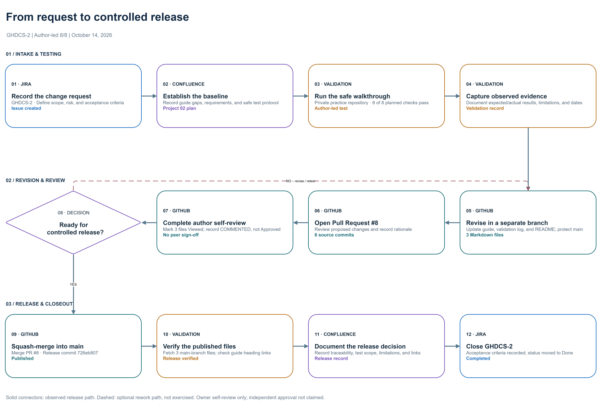

# Change-Control Workflow Diagram — GHDCS-3

**Audience:** Technical writers, documentation reviewers, and hiring managers looking for a reproducible example of a cross-tool documentation lifecycle.

**Status:** Released to `main` October 14, 2026, in [GitHub PR #9](https://github.com/michael-k-levesque/github-documentation-lab/pull/9) via squash commit [`d05f904a`](https://github.com/michael-k-levesque/github-documentation-lab/commit/d05f904a821cdf0198b6038b6b250b9ed48fe7cb). Owner inspected and accepted the diagram; no independent peer review is claimed.

**Author:** Repository owner. **Tool used:** diagrams.net (draw.io), web editor. **Source scenario:** [Jira GHDCS-2](https://mklevesque.atlassian.net/browse/GHDCS-2), [Project 02 Confluence record](https://mklevesque.atlassian.net/wiki/spaces/TWP/pages/1179652), and [merged GitHub Pull Request #8](https://github.com/michael-k-levesque/github-documentation-lab/pull/8).

## Diagram and source

- [Editable diagram source (draw.io)](diagrams/Project02_Change_Control_Workflow_Final.drawio)
- [Scalable SVG export with embedded editable data](diagrams/Project02_Change_Control_Workflow_Final.svg)

The final SVG was exported from diagrams.net with **Include a copy of my diagram** enabled. Its embedded `mxfile` graph can be reopened in diagrams.net for editing. SVG rendering can vary by viewer because this export uses `foreignObject` text and embedded image fallbacks. **If GitHub or another viewer does not display the SVG correctly, open the `.drawio` source in diagrams.net instead.** Do not treat the SVG alone as the canonical editable source.

## What the flow shows

This is a **case-study diagram of a completed documentation change**, not an assertion that all organizations use this exact workflow.

| Step | Owner or tool | Observed activity |
| --- | --- | --- |
| 01 | Jira | Record change request GHDCS-2 and acceptance criteria |
| 02 | Confluence | Establish baseline, scope and test protocol |
| 03 | Validation | Execute an author-led private-repository walkthrough (8 of 8 checks passed) |
| 04 | Validation | Capture observations and scope limitations |
| 05 | GitHub | Edit three Markdown files on a separate branch |
| 06 | GitHub | Open and document Pull Request #8 |
| 07 | GitHub | Perform author self-review and record COMMENTED review; no independent approval |
| 08 | Decision | Determine readiness for controlled release |
| 09 | GitHub | Squash-merge the approved release path to `main` |
| 10 | Validation | Retrieve the three published files and verify their contents |
| 11 | Confluence | Record the release decision, limitations, and links |
| 12 | Jira | Complete GHDCS-2 |

**Solid connectors** represent the observed completed release path. The **dashed NO/revise/retest connector** represents a sensible potential rework route from step 08 back to step 05. **That path was not exercised in the GHDCS-2 release.**

## Beginner editing instructions

1. Download the `.drawio` source above.
2. Visit [app.diagrams.net](https://app.diagrams.net/) and choose **Device** for file storage if prompted.
3. Select **File → Open from → Device**, then select the downloaded `.drawio` file.
4. To edit a label, double-click its shape, edit the text, then click blank canvas. Save a separate copy first if practicing.
5. To replace a shape, select it, then **Shift-click** the target shape in the left shapes palette. Confirm that its existing connectors remain attached.
6. To inspect connectors, single-click an arrow and examine both endpoints. Do not rely solely on arrows that happen to visually touch a shape.
7. To export, choose **File → Export as → SVG**. Use **Size: Diagram**, **Zoom: 100%**, and **Include a copy of my diagram** if editable SVG metadata is desired. A modest border (12 in the documented exercise) and opaque background are appropriate for this diagram.
8. Reopen the exported SVG in diagrams.net to verify embedded editability. Also preview it in your target viewer because SVG foreign-object support varies.

### Alternative formats and Microsoft Visio

Microsoft 365 Family does not include a full Visio editing license. This diagram was **not created or tested in Microsoft Visio**, and no native `.vsdx` file is claimed. diagrams.net is the verified editing environment here. The separate experimental Excel-to-Visio import data is not evidence of a successful Visio import.

## Validation record (October 14, 2026)

**Inputs:** User-finalized source `Project02_Change_Control_Workflow_Final.drawio` and exported `Project02_Change_Control_Workflow_Final.drawio.svg`.

**Structural checks:** Parsed both XML files with external entity resolution and network access disabled. Both encode the same 18 visual nodes (12 numbered steps, title/subtitle, row headers and footer) and 12 directed connectors. Step 08 is a rhombus/decision shape; every connector's source and target refer to present nodes. The solid YES path proceeds to release; the dashed NO path returns to revision.

**Rendering check:** Independently rendered the uploaded SVG as a raster preview and visually inspected the entire 12-step layout. Captions, decision text, arrows, and section dividers were readable; no substantive content was clipped in the tested rendering.

**Embedded-source check:** The SVG has a `content` attribute containing the diagrams.net `mxfile` and graph. The editable source and SVG were both checked for obvious credential patterns (common GitHub token prefixes and private key blocks), and no matches were found. **This limited pattern scan is not a complete security audit.**

**Source integrity:**
- Final `.drawio` SHA-256: `15c53a7bf205b56da71400445236782413c984690d948c1baaef9da3f690908b`
- Final `.svg` SHA-256: `7ecc4cdd07746b7792629c7fab4bab22727a9dfa0a2b5cd60a0f949ab5ed697e`
- Final source verified as exact Git blob `d9109405babb69fcf830148398b182584857a0d4`.
- Final SVG verified as exact Git blob `4bfb2807cbe027aef921912a73384f4ad3a104d4`.

**Post-release verification:** After [PR #9](https://github.com/michael-k-levesque/github-documentation-lab/pull/9) was merged, the original `.drawio` and `.svg` blob hashes were retrieved from `main` and matched the uploaded artifacts. The Markdown guide and its README link were also fetched from `main` and found in place. The SVG's byte contents were verified through its Git blob hash (the connector omits inline text for large files); the separately rendered SVG preview had already passed visual inspection. GitHub reports PR #9 closed and merged. Release commit: `d05f904a821cdf0198b6038b6b250b9ed48fe7cb`.

**Limitations:** The user visually confirmed the key connections within the diagrams.net editor. Connector endpoint existence was checked programmatically, but every possible external SVG viewer was not tested. No independent peer review, Visio operation, or SharePoint upload is claimed. Confluence and GitHub project-access settings may limit which linked records are visible to outside reviewers.

## Change control and reuse

This diagram deliverable was tracked in [Jira GHDCS-3](https://mklevesque.atlassian.net/browse/GHDCS-3), with validation and publication recorded in the [Confluence Project 02 diagram record](https://mklevesque.atlassian.net/wiki/spaces/TWP/pages/2850817). [PR #9](https://github.com/michael-k-levesque/github-documentation-lab/pull/9) was squash-merged into `main`, and the released source, SVG blob hashes, Markdown document, and README link were verified. For later changes, edit in a separate branch, review in a pull request, and verify on `main`. The original `.drawio` file remains the source of truth; regenerate the SVG whenever the diagram changes.
